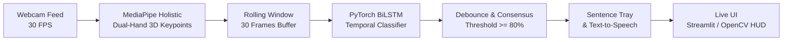

# 🤟 Vaani-ISL: Real-Time Indian Sign Language Interpreter

[](https://python.org)
[](https://pytorch.org)
[](https://mediapipe.dev)
[](https://opencv.org)
[](https://streamlit.io)
[](LICENSE)

An intelligent, low-latency **Indian Sign Language (ISL)** interpretation system built for hackathons and accessibility. Converts continuous dual-hand gestures into real-time text and spoken audio feedback using **MediaPipe**, **Deep BiLSTM Neural Networks**, and **Streamlit**.

---

## 📌 Problem Statement & Social Impact

Over **18 million individuals** in India are deaf or hard-of-hearing. Communication barriers persist because:
1. **ISL differs fundamentally from ASL**: Indian Sign Language relies heavily on **two-handed grammar** and dynamic spatial trajectories.
2. **Heavy computational models** (e.g. 3D CNNs) suffer from high latency and require expensive GPUs, failing on everyday laptops.
3. **Flicker & jitter**: Naive frame-by-frame classifiers fluctuate chaotically between signs during hand motion transitions.

**Vaani-ISL** solves this by extracting lightweight 3D skeletal landmarks in real-time, passing temporal sequences through a Bidirectional LSTM with debouncing filters, running at **> 45 FPS on standard laptops**.

---

## 🚀 Key Features

- 👐 **Dual-Hand Tracking**: Native tracking of 21 landmarks per hand (126 features) designed specifically for ISL's two-handed structure.
- ⚡ **Ultra-Low Latency (< 25ms)**: Skeletal landmark representation runs smoothly on Apple Silicon (MPS), CUDA, and standard CPUs.
- 🎯 **Temporal Debouncing Engine**: Rolling 30-frame window with 75% consensus requirement prevents sign flickering and false positives.
- 🗣️ **Asynchronous Voice Feedback (TTS)**: Automatically vocalizes recognized signs without pausing or stuttering the video feed.
- 📝 **Sentence Builder Tray**: Accumulates individual signs into readable sentences with one-click clear and speech playback.
- 🖥️ **Dual Presentation Modes**:
  - **Streamlit Web UI** (`app/streamlit_app.py`): Sleek judge-ready web dashboard with live controls and telemetry.
  - **OpenCV Desktop Runner** (`app/live_demo.py`): Zero-overhead native desktop app with broadcast HUD.

---

## 🏗️ System Architecture



Detailed architecture specs and math can be found in [docs/ARCHITECTURE.md](docs/ARCHITECTURE.md).

---

## 📂 Repository Structure

```text
ISL-RealTime-Interpreter/
├── app/
│   ├── live_demo.py             # Standalone high-performance desktop demo
│   └── streamlit_app.py         # Judge-facing presentation web dashboard
├── configs/
│   └── config.yaml              # Centralized configuration (camera, classes, model)
├── data/
│   ├── class_labels.json        # Class definitions & category taxonomy
│   ├── raw/                     # Raw video recordings (gitignored)
│   └── processed/               # Extracted landmark sequences (.npy) (gitignored)
├── docs/
│   ├── ARCHITECTURE.md          # Technical design, latency profile & diagrams
│   └── DATASET_GUIDE.md         # Guide for Teammate #1 (sources, recording protocol)
├── models/
│   └── checkpoints/             # Trained model weights (.pt)
├── scripts/
│   ├── 01_collect_data.py       # Custom dataset recorder via webcam
│   ├── 02_extract_landmarks.py  # Offline video-to-landmarks converter
│   ├── 03_train_model.py        # PyTorch BiLSTM model trainer (+ mock data generator)
│   └── test_camera.py           # Webcam & MediaPipe diagnostic test
├── src/
│   ├── capture/                 # Threaded low-latency video capture
│   ├── models/                  # BiLSTM and static classifier architectures
│   ├── pipeline/                # Rolling buffer inference & debouncing engine
│   ├── utils/                   # Non-blocking TTS engine & HUD visualizer
│   └── vision/                  # MediaPipe landmark extraction & rendering
├── WORKFLOW.md                  # Hackathon timeline, sprint roadmap & team ownership
├── requirements.txt             # Project dependencies
└── README.md
```

---

## ⚡ Quick Start Guide

### 1. Clone & Set Up Environment
```bash
# Clone the repository
git clone https://github.com/<your-username>/<repo-name>.git
cd "ISL - Hackathon"

# Create a virtual environment
python3 -m venv .venv
source .venv/bin/activate

# Install dependencies
pip install -r requirements.txt
```

### 2. Verify Webcam & MediaPipe
Ensure your camera and MediaPipe landmark detection are functioning:
```bash
python scripts/test_camera.py
```
*(Press `q` in the video window to exit)*

### 3. Immediate Pipeline Test (Zero Data Waiting!)
While the dataset is being recorded, generate mock sequences to verify the entire training and application pipeline:
```bash
# Generates synthetic data and trains an initial model checkpoint
python scripts/03_train_model.py --generate-mock
```

### 4. Run the Live Demo!
**Option A: Interactive Streamlit Web App (Recommended for presentation)**
```bash
streamlit run app/streamlit_app.py
```

**Option B: Low-Latency Desktop App**
```bash
python app/live_demo.py
```

---

## 👥 Hackathon Team & Workflow

| Role | Responsibility | Reference Guide |
| :--- | :--- | :--- |
| **Dataset Engineer** | Curate ISL data & record sequences using `01_collect_data.py` | [docs/DATASET_GUIDE.md](docs/DATASET_GUIDE.md) |
| **Workflow Lead** | Coordinate sprint milestones, git branches & pitch presentation | [WORKFLOW.md](WORKFLOW.md) |
| **Model Architect** | Optimize temporal BiLSTM, tune hyperparameters & loss | [src/models/](src/models/) |
| **UI & Systems Lead** | Live video stream, debounce thresholds, TTS & UI polish | [app/](app/) |

Check out the full 24-hour milestone breakdown in [WORKFLOW.md](WORKFLOW.md).

---

## 📜 License
This project is licensed under the [MIT License](LICENSE).
