# ⏱️ Hackathon Workflow & Execution Blueprint

> **Notice for Team**: This workflow is maintained for our 4-person hackathon team to ensure zero bottlenecking, clear ownership, and rapid iterative delivery.

---

## 👥 1. Team Roles & Ownership Matrix

| Member | Primary Role | Domain Responsibilities | Deliverables |
| :--- | :--- | :--- | :--- |
| **Member 1** | **Dataset & Annotation Engineer** | Curate public ISL datasets (INCLUDE / ISL-CSLTR) + record custom samples using `scripts/01_collect_data.py`. | Clean `.npy` landmark sequences in `data/processed/` with class distribution report. |
| **Member 2** | **Workflow & Systems Architect** | Manage project milestones, API contracts, integration branches, performance benchmarks, and slide deck. | Maintained `WORKFLOW.md`, test verification, presentation deck & demo script. |
| **Member 3** | **Vision & Deep Learning Lead** | Train and tune temporal BiLSTM / GRU models, handle class imbalance, evaluate precision/recall & latency. | High-accuracy weights (`models/checkpoints/isl_bilstm.pt`) & evaluation metrics. |
| **Member 4** | **Full-Stack UI & Integration Lead** | Build low-latency live camera streaming, debouncing logic, Streamlit UI, TTS audio engine, and HUD overlays. | Working live demo (`app/live_demo.py` & `app/streamlit_app.py`). |

---

## 🕒 2. 24-Hour Hackathon Sprint Milestones

```mermaid
gantt
    title 24-Hour ISL Hackathon Timeline
    dateFormat  X
    axisFormat %d hrs
    section Phase 1: Setup
    Repo & Environment Setup       :0, 2
    Data Taxonomy & Tooling       :1, 4
    section Phase 2: Core ML
    Dataset Collection & Extraction:3, 10
    BiLSTM Model Prototyping       :6, 12
    section Phase 3: Pipeline
    Inference Debouncing & Smoothing:10, 16
    TTS Audio & Sentence Engine    :14, 18
    section Phase 4: Integration
    End-to-End Streamlit Demo      :16, 21
    Latency Optimization           :19, 22
    section Phase 5: Demo Pitch
    Rehearsals & Pitch Polish      :21, 24
```

### **Phase 1 (Hours 0 – 4): Setup & Baseline Agreement**
- [x] Repository initialized with modular code structure, CI, and `.gitignore`.
- [ ] Every teammate clones the repo and runs `python scripts/test_camera.py` to verify webcam and MediaPipe.
- [ ] Member 1 locks the 10 target ISL gestures in `configs/config.yaml`.
- [ ] Member 3 runs `python scripts/03_train_model.py --generate-mock` to produce initial dummy weights so Members 2 & 4 can build the UI and pipeline in parallel without waiting!

### **Phase 2 (Hours 4 – 10): Data Acquisition & Initial Training**
- [ ] Member 1 records 20–30 sequences per class across different team members (to prevent single-user bias) using `python scripts/01_collect_data.py`.
- [ ] Member 3 trains the first real BiLSTM checkpoint on `data/processed/`.
- [ ] Target milestone: **Validation Accuracy > 85% on 10 classes**.

### **Phase 3 (Hours 10 – 16): Real-Time Engineering & Debouncing**
- [ ] Member 4 tests live prediction jitter. Tune `prediction_threshold` (0.80) and `debounce_frames` (8-10) in `configs/config.yaml`.
- [ ] Verify two-handed signs: Ensure Left Hand + Right Hand coordinates do not flip when hands cross over.
- [ ] Connect `TextToSpeechEngine` to auto-vocalize committed gestures.

### **Phase 4 (Hours 16 – 21): Full Application Polish**
- [ ] Integrate sentence construction tray ("Hello" -> "I Need" -> "Help").
- [ ] Build judge-facing UI in `app/streamlit_app.py` with dark mode, real-time FPS counter, and confidence meters.
- [ ] Measure end-to-end latency: Camera capture -> MediaPipe -> BiLSTM -> UI update must be `< 50ms`.

### **Phase 5 (Hours 21 – 24): Rehearsals, Video Backup & Pitch**
- [ ] Record a 60-second backup video of the live demo working (crucial for hackathons in case webcam hardware fails on stage!).
- [ ] Prepare slide deck highlighting:
  1. Real-World Need (18M deaf Indians).
  2. Why ISL is harder than ASL (two-handed grammar, lack of large datasets).
  3. Our Technical Innovation (Keypoint-based temporal modeling + debouncing vs heavy raw video 3D CNNs).
  4. Live Demo.

---

## 🌿 3. Git Collaboration Strategy

To avoid merge conflicts during high-speed hackathon coding:

1. **`main` Branch**: Always protected, production-ready, working demo code only.
2. **Feature Branches**:
   - `feat/dataset-member1`
   - `feat/model-tuning-member3`
   - `feat/ui-app-member4`
3. **Commit Convention**:
   - `feat: add 5 new emergency signs to dataset`
   - `fix: prevent camera buffer lag on macos`
   - `docs: update workflow milestones`

---

## 🎯 4. Interface Data Contract (Between Teammates)

- **Landmark Array Shape**:
  - Sequence: `(30, 126)` numpy array `float32`.
  - Stored at: `data/processed/<class_name>/seq_<timestamp>.npy`.
  - Feature 0–62: Left Hand (21 points * (x,y,z)).
  - Feature 63–125: Right Hand (21 points * (x,y,z)).
- **Model Checkpoint**:
  - Saved at: `models/checkpoints/isl_bilstm.pt`.
  - Must include: `state_dict`, `class_names`, and hyperparameter dictionary.
